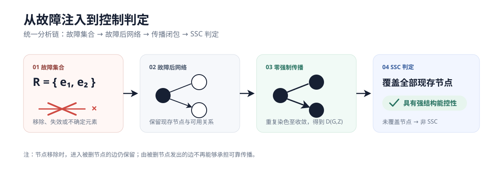
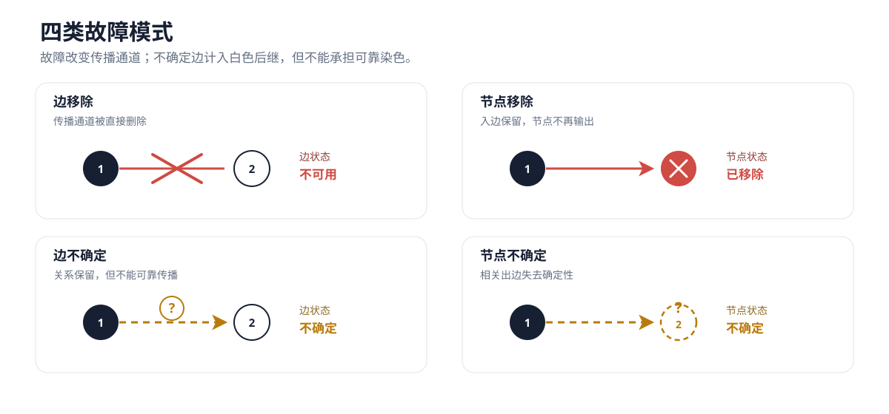
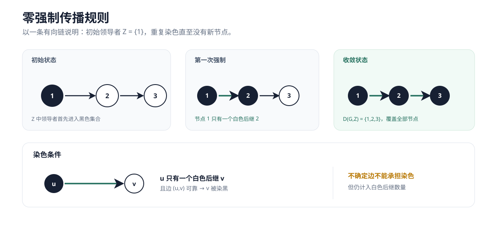
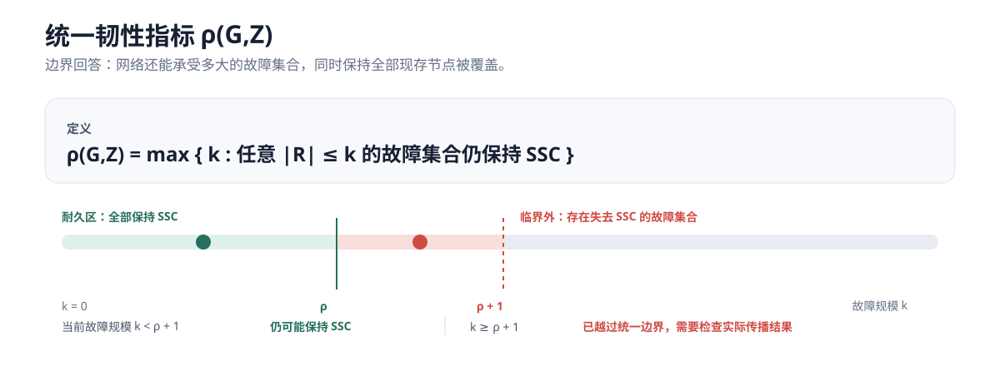
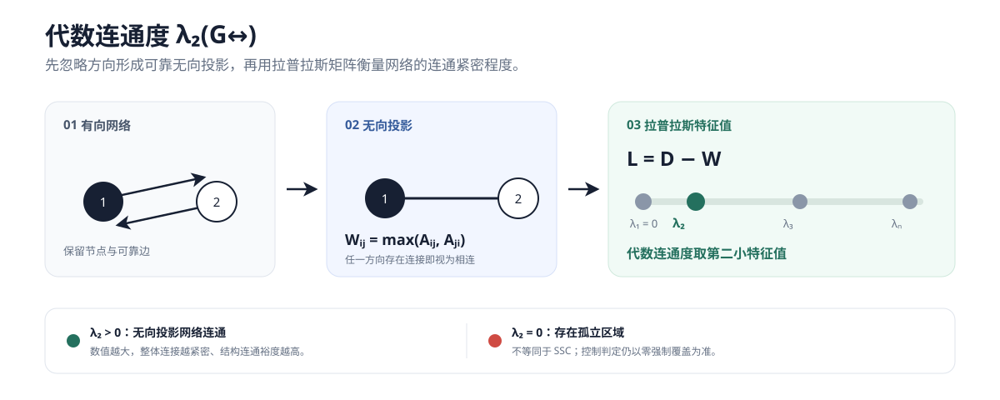

# 网络故障影响与强结构能控性实验台

<p align="center">
  动态展示断边、节点移除和连接不确定性如何影响零强制传播、节点覆盖与网络韧性。
</p>

<p align="center">
  <a href="https://muhaduxa523-dotcom.github.io/network-resilience-lab/"><strong>进入在线实验台 →</strong></a>
</p>

<p align="center">
  
</p>

## 四类故障模式

故障不只意味着“删掉一条边”。实验台统一比较边移除、节点移除、边不确定和节点不确定，并区分结构删除与传播可靠性变化。

<p align="center">
  
</p>

## 零强制传播与 SSC

领导者初始被染黑。若一个黑节点只有一个白色后继，且对应连接可靠，则这个白色后继会被强制染色；重复该过程直到收敛。全部**现存节点**都进入派生集合 `D(G,Z)` 时，网络才具有强结构能控性（SSC）。

<p align="center">
  
</p>

> 不确定边会计入白色后继数量，但不能承担可靠染色。节点被移除后，进入该节点的边仍然存在；由该节点发出的边不再能够承担可靠传播。全部节点被移除时，网络已经完全失效，不属于 SSC。

## 统一韧性指标

`ρ(G,Z)` 表示网络仍能保持 SSC 的最大故障规模。`ρ + 1` 是首次可能出现“存在故障集合导致非 SSC”的临界规模。

<p align="center">
  
</p>

## 代数连通度

实验台同时显示可靠边无向投影网络的代数连通度 `λ₂`：`λ₂ > 0` 表示投影网络连通，`λ₂ = 0` 表示存在孤立区域。它用于比较故障前后的结构连通裕度，不替代零强制覆盖和 SSC 判定。

<p align="center">
  
</p>

## 使用方式

1. 在顶部选择一种故障模式。
2. 点击图中的节点或有向边注入故障；页面不会在切换模式时自动注入。
3. 点击“播放影响”，观察传播路径、派生覆盖和最终判定。
4. 使用“拓扑设置”调整领导者、连接或接入邻接矩阵。
5. 使用“导出 PNG”保存适合论文和汇报使用的拓扑图。

默认示例固定为 **7 个节点、10 条有向边、领导者 Z = {1,2,3}**。有向关系用箭头表示，无向关系展开为两条反向有向边。

## 本地运行

这个目录是纯静态版本，不需要 Python 服务：

```bash
python -m http.server 8765
```

然后打开 `http://127.0.0.1:8765/`。实验库后端属于可选扩展，不在 GitHub Pages 静态版本中运行。

## 项目结构

```text
.
├── index.html                 # 交互式实验台
├── assets/                    # 原理说明图
├── README.md
└── .nojekyll
```
